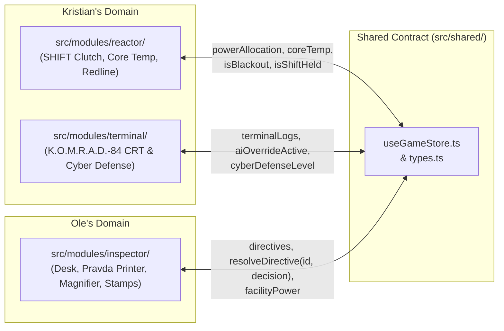

# PLAN.md — Technical Roadmap & Phase 1 Infrastructure Specification

> **Project:** **Meltdown is Propaganda** (*A Soviet Night Shift Simulator*)  
> **Event:** GitHub Game Off 2026 (Theme: **SHIFT**)  
> **Current Status:** 📐 **Planning Phase** *(No game code or Phase 1 infrastructure is built until explicit go-ahead)*

---

## 1. Naming & Typography Convention

- **Official Title:** **Meltdown is Propaganda**
- **Subtitle:** *A Soviet Night Shift Simulator*
- **Searchability vs. Diegetic Display Rule:**
  - In source code, repository metadata, and on the itch.io store page, the title is always written with standard Latin letters (**Meltdown is Propaganda**) to ensure full searchability.
  - Visually inside the game UI, title headers, panel labels, and propaganda banners use the **`Kremlin`** font from DaFont (bundled locally via `@font-face` in `public/fonts/`), paired with `VT323` (CRT terminal) and `Courier Prime` (Pravda dot-matrix directives & Security Manual).

---

## 2. Phase 1 Checklist: Shared Core Infrastructure (To Be Built on `main` First)

Before **Kristian** (`reactor` & `terminal`) and **Ole** (`inspector`) split off to build gameplay mechanics on their respective branches, the following 5 shared infrastructure pieces will be implemented on `main` and synced to both branches:

### [ ] 1. itch.io Sub-Directory & Local Font Compatibility
- Configure `base: './'` in `vite.config.ts`.
- Bundle the **`Kremlin`** font (from DaFont) locally in `public/fonts/` and register it via `@font-face` (`--font-kremlin`) in `src/index.css` (removing `Russo One`).
- Use strictly relative paths (`./...`) for all static assets, fonts, and bundled chunks so the production build runs inside itch.io's sub-directory iframe without white-screening or broken paths.

### [ ] 2. Locked 16:9 Viewport Scaler (`1600x900`) — `src/shared/ViewportScaler.tsx`
- Lock the internal game canvas to a fixed **`1600x900`** pixel coordinate system (`16:9` aspect ratio).
- Automatically scale the canvas (`transform: scale(...)`, `transform-origin: center center`) to fit any browser window or itch.io embed while preserving aspect ratio and centering with black letterbox bars.
- Disable accidental text selection (`user-select: none` / `select-none`) and right-click context menus (`onContextMenu={(e) => e.preventDefault()}`) across the viewport so dragging documents, moving the magnifying glass, and throwing switches feel like a native desktop game.
- Expose the current scale factor via React context (`useViewportScale()`) so pointer drag deltas (`clientX` / `clientY`) inside `inspector` and `reactor` map 1:1 to the `1600x900` coordinate space.

### [ ] 3. Web Audio Unlock & Boot Screen ("Main Breaker") — `src/shared/MainBreakerOverlay.tsx`
- Modern browsers suspend the Web Audio API (`AudioContext`) until the first user interaction.
- Render a diegetic 1984 Soviet industrial breaker box overlay on initial load featuring a heavy Bakelite switch labeled:
  `[ ENGAGE MAIN REACTOR BREAKER ]`
- Clicking the breaker switch initializes and resumes the singleton `AudioContext`, triggers a procedural mechanical breaker clank + 60Hz transformer hum kick-in, and sets `isBreakerEngaged = true` in the shared store to start the shift.

### [ ] 4. `F2` Developer Debug Overlay — `src/shared/DebugMenu.tsx`
- A floating developer panel toggled with the **`F2`** key so Kristian and Ole can test their modules in complete isolation without waiting on each other's systems:
  - **For Ole (`src/modules/inspector/`):**
    - `[+ Spawn Genuine Directive]` — Pushes a valid Pravda directive onto the desk.
    - `[+ Spawn CIA Forgery]` — Pushes a forged directive with detectable flaws (watermark, authorization cipher, ink color, or ministry typo).
    - `[Clear Desk]` — Empties all active directives from the desk.
    - `[Pause Reactor Meltdown (God Mode)]` — Freezes core temperature escalation and blackouts so Ole can test document dragging, the magnifying glass, stamps, and the Security Manual in peace without dying.
  - **For Kristian (`src/modules/reactor/` & `src/modules/terminal/`):**
    - `[Set Core Temp: Normal (300°C) / Critical (950°C)]` — Instantly jumps reactor core temperature to test gauges, alarms, and thermal loops.
    - `[Trigger Redline Blackout]` — Forces a `>100 MW` Redline overload blackout state.
    - `[Trigger K.O.M.R.A.D.-84 Gaslight Message]` — Pushes an ideological gaslighting message/override attempt to the CRT terminal.
    - `[Skip to Shift 1 / Shift 2 / Shift 3]` — Switches active shift difficulty parameters.

### [ ] 5. Shared Zustand Contract (`src/shared/types.ts` & `src/shared/useGameStore.ts`)
- Establish the cross-module state store and TypeScript interfaces so `reactor`, `terminal`, and `inspector` never import directly from one another.

---

## 3. Proposed Shared Contract Specification (`src/shared/`)

### Data Flow Between Kristian & Ole



### Proposed TypeScript Interfaces (`src/shared/types.ts`)

```ts
export type SubsystemKey = 'cooling' | 'defense' | 'facility'

export type StampType =
  | 'MINATOM_OFFICIAL'
  | 'POLITBURO_URGENT'
  | 'KGB_DIRECTORATE_4'
  | 'PLANT_INTERNAL'

export type InkColor =
  | 'SOVIET_CRIMSON'
  | 'BUREAU_VIOLET'
  | 'FADED_BLACK'
  | 'IMPERIALIST_BLUE'

export type DirectiveDecision = 'APPROVED' | 'SHREDDED'

export interface PrintedDirective {
  id: string
  title: string
  bodyText: string
  isCiaForgery: boolean
  stampType: StampType
  inkColor: InkColor
  authorizationCode: string
  watermark: string
  flawDescription: string | null
  status: 'PENDING' | DirectiveDecision
}

export interface TerminalLogEntry {
  id: string
  timestamp: string
  sender: 'K.O.M.R.A.D.-84' | 'SYSTEM' | 'OPERATOR'
  text: string
  type: 'INFO' | 'WARNING' | 'GASLIGHT' | 'OVERRIDE'
}

export interface GameState {
  // Boot & Shift State
  isBreakerEngaged: boolean
  currentShift: 1 | 2 | 3
  godMode: boolean

  // Reactor & Power Shifting (Kristian -> Shared -> Ole)
  powerAllocation: {
    cooling: number   // MW routed to core cooling pumps
    defense: number   // MW routed to K.O.M.R.A.D. firewall / anti-sabotage
    facility: number  // MW routed to desk lamp & Pravda printer speed
  }
  coreTemp: number    // Nominal ~300°C, Meltdown >1000°C
  isBlackout: boolean // Triggered when Redline (>100 MW total) overloads grid

  // K.O.M.R.A.D.-84 Terminal (Kristian -> Shared)
  terminalLogs: TerminalLogEntry[]

  // Pravda Printer & Document Inspector (Ole -> Shared -> Kristian)
  directives: PrintedDirective[]

  // Cross-Module Actions
  engageMainBreaker: () => void
  setShift: (shift: 1 | 2 | 3) => void
  toggleGodMode: () => void
  setPowerAllocation: (next: Partial<GameState['powerAllocation']>) => void
  setCoreTemp: (temp: number) => void
  triggerRedlineBlackout: () => void
  triggerKomradGaslight: () => void
  spawnDirective: (isCiaForgery: boolean) => void
  clearDirectives: () => void
  resolveDirective: (id: string, decision: DirectiveDecision) => void
}
```

### How Cross-Module Effects Work:
1. **Kristian -> Ole (`powerAllocation.facility` & `isBlackout`):**
   - Ole's `inspector` module reads `powerAllocation.facility` and `isBlackout` from `useGameStore`.
   - If Kristian starves `facility` power or triggers a Redline blackout, Ole's desk lamp flickers/dims and the Pravda printer slows down or stalls.
2. **Ole -> Kristian (`resolveDirective(id, decision)`):**
   - When Ole stamps a document `APPROVED` or `SHREDDED`, `inspector` calls `useGameStore.getState().resolveDirective(id, decision)`.
   - Approving a **CIA Forgery** triggers a sabotage penalty in the store (e.g., spiking `coreTemp`, draining `cooling`, or triggering a K.O.M.R.A.D.-84 lock), which Kristian's `reactor` and `terminal` modules immediately react to.
   - Shredding a **Genuine Directive** logs a bureaucratic infraction from Commissar Volkov on the CRT terminal.
