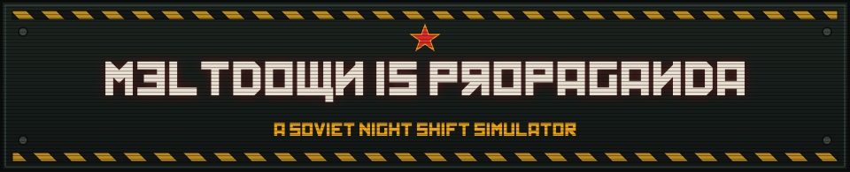

<p align="center">
  
</p>

# ☢️ Meltdown is Propaganda
### *A Soviet Night Shift Simulator*

> *"Comrade Operator: Reports of a core thermal anomaly are bourgeois fabrication. Meltdown is propaganda. Do not touch the cooling valves. Glory to the Collective."*
> — **K.O.M.R.A.D.-84**, Automated Plant Supervisor

**Meltdown is Propaganda** (*A Soviet Night Shift Simulator*) is a **100% physical first-person 3D Soviet control-room thriller** combining frantic power-grid juggling with paranoid document inspection (*Papers, Please* meets *Chernobyl* with the tactile 3D micro-pixel aesthetic of *Buckshot Roulette* and *Inscryption*), built for **GitHub Game Off 2026** (Theme: **SHIFT**).

---

## 📖 High Concept & The Three Layers of `SHIFT`

The year is **1984** in an alternative-history Soviet Union defined by heavy analog **Cassette Futurism** and **Atompunk** engineering. You are the lone night-shift operator locked inside the 3D concrete bunker of **People's Automated Nuclear Plant No. 4 (Sector 84)**.

The jam theme **SHIFT** drives the game on three levels:

1. **The Night Shift (Time & Survival):**
   Survive **5 increasingly chaotic night shifts** from **00:00 to 06:00** without letting the reactor core reach `1000°C` meltdown—or accumulating **3 Treason Strikes** and being shipped to Siberia.
2. **Power Shifting (The Physical 3D `SHIFT` Clutch):**
   The reactor safely outputs **100 MW**, while maximum subsystem demand reaches **180 MW**. You must hold the physical **`SHIFT`** key on your keyboard—physically rotating the heavy Bakelite 3D clutch lever into its slot with sparks and mechanical clanks—to reroute megawatts between **COOLING**, **DEFENSE**, and **FACILITY**. Overclocking into the **Redline (`101–180 MW`)** grants emergency power at the risk of severe grid instability and facility-wide blackouts.
3. **Reality Shifting (Propaganda vs. Reality):**
   The state AI **K.O.M.R.A.D.-84** is ideologically programmed to deny that a Soviet reactor can malfunction, gaslighting you and sabotaging power allocation while the **CIA** infiltrates your 3D dot-matrix printer with forged sabotage orders.

---

## 🎛️ 100% True 3D First-Person Control Room (Zero 2D HTML Overlays)

There are **no** 2D split-screen panels, flat DOM cards, or R3F `<Html>` overlays. Every gauge needle, rotary valve wheel, Bakelite lever, CRT monitor glass, tractor-feed paper sheet, UV magnifying glass, and rubber stamp is a **real 3D mesh** inside a continuous 3D bunker, operated directly via 3D raycasting (`onPointerDown`, `onPointerMove`, `onPointerUp`, `onClick`):

```text
+-----------------------------------+-----------------------------------+
| LEFT 3D CONSOLE (Hotkeys [1]/[3]) | CENTER 3D CONSOLE (Hotkey [2])    |
| <ReactorStation3D /> (Kristian)   | <TerminalStation3D /> (Kristian)  |
| - Cylindrical 3D gauges & needles | - Physical 3D CRT monitor & keys  |
| - 3D rotary cooling valve wheels  | - Curved 3D glass CanvasTexture   |
| - Hinged 3D AZ-5 hazard cover     |   with phosphor #33ff66 scanlines |
| - 3D [SHIFT] clutch lever &       | - K.O.M.R.A.D.-84 gaslighting &   |
|   emissive 3D MW indicator blocks |   CIA ARPANET firewall defense    |
+-----------------------------------+-----------------------------------+
| RIGHT 3D OPERATOR DESK (Key [4])  | DYNAMIC 3D BUNKER LIGHTING        |
| <InspectorDesk3D /> (Ole)         | (src/shared/ControlRoomScene.tsx) |
| - 3D Pravda dot-matrix printer    | - FACILITY MW drives the 3D desk  |
| - 3D paper meshes w/ CanvasTexture|   lamp spotlight & flicker        |
| - 3D KGB Security Manual '84      | - CRT emits #33ff66 point light   |
| - 3D UV Magnifying Glass lens     | - Rotating #ff2a2a ceiling klaxon |
| - Animated 3D [APPROVE]/[SHRED]   |   casts red shadows in Redline    |
+-----------------------------------+-----------------------------------+
```

### 🎥 Free 3D Camera, Blind Spots & Direct Raycasting
- **Free 3D Look & Blind Spots (`[0]` / `[ESC]`):** Sit in the operator's position and look freely around the 3D bunker using the mouse or `WASD` / arrow keys. Turning toward the right-hand Inspector Desk or center CRT terminal places the left-hand reactor gauges out of view—forcing you to rely on 3D spatial audio cues and warning lights.
- **Station Zoom (`[1]`–`[4]` or Click 3D Console):** Smoothly interpolates the 3D camera into a close-up of the selected 3D station for precise 3D raycast interaction.

---

## ⚖️ Directive Consequence Matrix

Every 3D paper directive printed onto the operator's desk directly impacts the reactor and your standing with the Party:

| Directive Type | Operator 3D Stamp | In-Game Consequence |
| :--- | :--- | :--- |
| **Genuine Party Order** | `APPROVED` ✅ | Order executed safely (e.g., auxiliary coolant boost or grid stabilization). |
| **Genuine Party Order** | `SHREDDED` ❌ | **Suspected Treason (`+1 Strike`).** K.O.M.R.A.D.-84 logs a reprimand. `3 Strikes` = Gulag Game Over. |
| **Forged CIA Sabotage** | `SHREDDED` ✅ | Sabotage foiled! Reactor stability bonus and ideological commendation. |
| **Forged CIA Sabotage** | `APPROVED` 💥 | **Sabotage Executed!** Core temperature spikes (`+200°C`), cooling pumps lock, or K.O.M.R.A.D.-84 is hijacked. |

---

## 🗓️ 5-Shift Campaign Progression

Each night shift runs from **00:00 to 06:00** (~3–4 minutes of real-time pressure):

- **Shift 1 — Orientation:** Stable core. The 3D Security Manual only requires verifying **Valid Ministry Stamps** and **Date (`1984`)**.
- **Shift 2 — Power Crunch:** Elevated baseline core heat forces constant 3D `SHIFT`-clutch juggling. Manual adds **Authorization Ciphers**.
- **Shift 3 — Lens & Watermarks:** CIA forgeries now feature replica stamps. You must move the **3D UV Magnifying Glass** over 3D paper directives to reveal hidden **UV Watermarks** and micro-text typos.
- **Shift 4 — K.O.M.R.A.D.-84 Override:** The AI begins forcibly hijacking the Power Matrix to meet Five-Year Plan quotas. Balance blackouts in the dark while 3D directives pile up.
- **Shift 5 — Redline Finale:** Total crisis. Controlled overclocking in the **Redline (`>100 MW`)**, multi-layered CIA forgeries, and continuous thermal management until `06:00`.

---

## 🖥️ 3D Micro-Pixelart Aesthetic & Typography

Inspired by *Buckshot Roulette* and *Inscryption*, all 3D meshes use crisp procedural pixel `CanvasTexture`s with `THREE.NearestFilter` (zero texture blur) and a strict **1984 Soviet Industrial Hardware Palette**:

- **Mandatory 3D Drag-Operated Levers:** Every 3D lever (`spak`), pump throw, and power routing handle is physically grabbed and dragged up or down in 3D space via raycast pointer events (`onPointerDown` + `onPointerMove` + `onPointerUp`).
- **Palette:**
  - Bakelite Black: `#141414`
  - Soviet Panel Green: `#23312b` (and `#364940`)
  - CRT Phosphor Green: `#33ff66` (and `#061a0c`)
  - Industrial Hazard Yellow: `#ffb000`
  - Crimson Alarm / Stamp Red: `#ff2a2a`
  - Aged Tractor Paper / Gauge Dials: `#e6dec3`
- **Title Searchability Rule:** Written as **Meltdown is Propaganda** in standard Latin text across metadata and itch.io for searchability, and rendered in-game using the **`Kremlin`** display font.

| 3D Surface / Texture | Typography | Role |
| :--- | :--- | :--- |
| **3D Stenciled Steel Plates & Branding** | `Kremlin` (DaFont) | 3D engraved metal labels, warning placards, and switch plates |
| **3D K.O.M.R.A.D.-84 Curved CRT Mesh** | `VT323` | Phosphor-green `CanvasTexture` terminal, diagnostics, and 3D digital readouts |
| **3D Tractor-Feed Directives & Manual** | `Courier Prime` | 3D paper directive textures, 3D Security Manual pages, and 3D rubber ink stamps |

---

## 🏗️ Tech Stack & Modular 3D Architecture

- **Framework:** React 19 + TypeScript + Vite (`base: './'` for itch.io embed support)
- **3D Engine:** Three.js + React Three Fiber (`three`, `@types/three`, `@react-three/fiber`, `@react-three/drei`) with 60 FPS `useFrame` + `useRef` direct state reads (`useGameStore.getState()`) and `THREE.NearestFilter` micro-pixel `CanvasTexture`s
- **Audio:** Zero-dependency procedural **Web Audio API** synthesizer (60Hz reactor hum, Geiger clicks, Bakelite switch clanks, dot-matrix printer screech)
- **State Management:** `zustand` ([`src/shared/useGameStore.ts`](src/shared/useGameStore.ts))

To guarantee zero merge conflicts during parallel AI-assisted development, the repository enforces strict 3D module boundaries:

```text
src/
├── modules/
│   ├── reactor/     # Kristian's Domain — Exports <ReactorStation3D /> (3D gauges, AZ-5, valves, [SHIFT] clutch & MW blocks)
│   ├── terminal/    # Kristian's Domain — Exports <TerminalStation3D /> (3D CRT monitor mesh, 3D keyboard & CanvasTexture)
│   └── inspector/   # Ole's Domain      — Exports <InspectorDesk3D /> (3D desk, Pravda printer, 3D papers, UV lens & 3D stamps)
└── shared/          # Shared Contract   — types.ts, useGameStore.ts, ControlRoomScene.tsx, CameraController.tsx, DebugMenu.tsx
```

See [`PLAN.md`](PLAN.md) for the complete 4-phase development roadmap and [`AGENTS.md`](AGENTS.md) for AI agent collaboration rules.

---

## 🚀 Getting Started

```bash
# Install dependencies
npm install

# Start local development server
npm run dev

# Type-check and build production bundle
npm run build

# Run linter
npm run lint
```

---

## 👥 Team & Branch Workflow

- **Kristian** (`Kristian` branch) — `<ReactorStation3D />` & `<TerminalStation3D />`
- **Ole** (`Ole` branch) — `<InspectorDesk3D />`
- **`main`** — Shared 3D bunker infrastructure & verified integration branch
