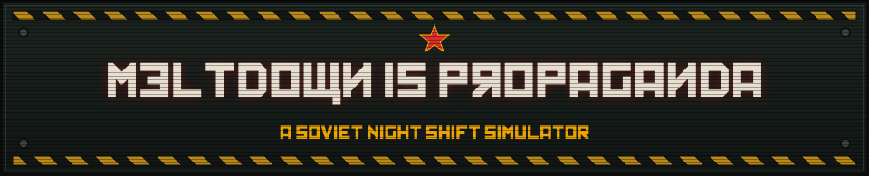

<p align="center">
  
</p>

# ☢️ Meltdown is Propaganda
### *A Soviet Night Shift Simulator*

> *"Comrade Operator: Reports of a core thermal anomaly are bourgeois fabrication. Meltdown is propaganda. Do not touch the cooling valves. Glory to the Collective."*
> — **K.O.M.R.A.D.-84**, Automated Plant Supervisor

**Meltdown is Propaganda** (*A Soviet Night Shift Simulator*) is a **100% physical first-person 3D Soviet RBMK-1000 control-room thriller** combining high-stakes reactor thermodynamics and 1000 MW grid dispatching with cyber defense, ideological interrogation, and paranoid document inspection (*Papers, Please* meets *Chernobyl* with the tactile 3D micro-pixel chiaroscuro aesthetic of *Buckshot Roulette* and *Inscryption*), built for **GitHub Game Off 2026** (Theme: **SHIFT**).

---

## 📖 High Concept & The Three Layers of `SHIFT`

The year is **1984** in an alternative-history Soviet Union defined by heavy analog **Cassette Futurism** and **Atompunk** engineering. You arrive via the **MCR-4 Elevator Lobby** and airlock as the lone night-shift operator inside the 3D Main Control Room bunker of **People's Automated Nuclear Plant No. 4 (Sector 84)**.

The jam theme **SHIFT** drives the game on three interconnected levels:

1. **The 3-Shift Campaign — *Operation Clear Sky* (`00:00`–`06:00`):**
   Survive **3 escalating 10-minute night shifts** (with a **Day-1 clock freeze during the startup tutorial** so new operators can train safely) without letting the RBMK-1000 core melt down—or accumulating **6 Treason Strikes** and facing K.O.M.R.A.D.-84's Siberia liquidation ending.
2. **Power & Reactivity Shifting (`1000 MW` Grid & `3000 MWh` Battery):**
   Dispatch up to **1000 MW** across 6 regional Soviet substations (**Pripyat, Kolkhoz, Duga-1, KGB Line, Vodka Plant, Steel Works**) while balancing steam pressure, drum water level, control rods, positive void coefficient, Xenon-135 poisoning, a **`3000 MWh`** station battery buffer, and synchronous **50.0 Hz** turbine locking. Hold **`SHIFT`** to sprint across the hall or fine-tune 3D valves and rod drives in **`±1%`** increments via scroll wheel.
3. **Reality Shifting (Propaganda vs. Physics & Espionage):**
   **K.O.M.R.A.D.-84**—voiced by a 100%-manifest procedural PA-vocoder VOX engine—insists a Soviet reactor cannot fail while pressuring you to prioritize **Duga-1** and **KGB** megawatt quotas over **Pripyat**. Meanwhile, **Operation Langley Leak** infiltrates your `ISKRA-84` computer (`ZASHCHITA-84` & `POLIT-LINK 84`) and slips forged sabotage directives onto your `Pravda-84` dot-matrix printer, forcing a quiet tug-of-war between blind **Party Compliance (`complianceScore`)** and uncovering **Clear Sky Truth (`truthIntel`)**.

---

## 🕵️ *Operation Clear Sky* — 3-Shift Storyline & 4 Endings

Plant No. 4 (Sector 84) is secretly a dual-purpose energetic node feeding Duga over-the-horizon radar and KGB telemetry trunks. Across 3 shifts, every lever pull, firewall decision, and ideological answer shapes the outcome:

- **Act I (Shift 1) — *Routine & Duga Pulse*:** Enter via the **MCR-4 Elevator Lobby**, unlock the control room by reading Commissar Volkov's `P.O.S.T.-84` briefing on `ISKRA-84`, pass the 8-step `WE-PAD 84` cold-start certification, and investigate anomalous Duga-1 carrier logs (`CLEAR_SKY_LOG`).
- **Act II (Shift 2) — *Operation Langley Leak*:** Duga & KGB power demand spikes while **Agent Smith** impersonates command in `POLIT-LINK 84`, `spy_cat` packet waves hit `ZASHCHITA-84`, and leaked Duga telemetry (`DUGA_DUMP_84`) surfaces on the archive bus.
- **Act III (Shift 3) — *Propaganda vs. Physics*:** Hold the unstable core together until `06:00`, secure Volkov's classified memorandum (`VOLKOV_MEMO_RAW`), and choose Sector 84's fate on the diegetic `SHIFT-84` shift debrief.

| Ending | How It Triggers | Consequence |
| :--- | :--- | :--- |
| **Ending A — Good Bureaucrat** | Reach `06:00` on Shift 3 while obeying Commissar Volkov & K.O.M.R.A.D.-84 (`truthIntel < 3`). | Promoted as a model Soviet technocrat; Duga continues concealing the reactor flaws. |
| **Ending B — Clear Sky Whistleblower** | Archive all **3 golden Clear Sky evidence files** (`truthIntel >= 3`) in `ZASHCHITA-84` and reach `06:00` on Shift 3. | Expose Directive 84-Z and the Sector 84 cover-up on the `SHIFT-84` broadcast report. |
| **Ending C — Siberia Liquidation** | Accumulate **6 Treason Strikes** across `POLIT-LINK 84`, `ZASHCHITA-84`, `Pravda-84`, or reactor defiance. | K.O.M.R.A.D.-84 locks the bunker, triggers Siberia liquidation, and **wipes your saved shift progress**. |
| **Ending D — Core Meltdown** | Catastrophic RBMK-1000 thermal runaway, void excursion, or vessel overpressure failure. | Total reactor catastrophe across Sector 84 and Pripyat. |

---

## 🖥️ `ISKRA-84` & `SOV-OS 84` Terminal Suite (100% Diegetic 3D CRT)

Every desktop program runs directly inside the 3D `ISKRA-84` CRT mesh on the Shift Supervisor Desk (`DesktopComputer3D.tsx`):

- **`P.O.S.T.-84` (Ministerial Dispatch):** Receives Commissar Volkov's pre-shift briefings and pure-MW grid orders. Opening Volkov's Shift 1 briefing disengages the control-room safety interlock (`POLIT-LINK 84`, `ZASHCHITA-84`, and `UNIT` panels unlock once briefed).
- **`POLIT-LINK 84` (Ideological Link & Agent Smith Duel):** Timed interrogation duels with `K.O.M.R.A.D.-84`, `Agent Smith` impostor verification battles, and Shift 1–3 loyalty/intel dilemmas that shift `complianceScore`, `truthIntel`, and Treason Strikes.
- **`ZASHCHITA-84` (Firewall & Packet Inspector):** Live network defense against CIA intrusions (`spy_cat` waves and spoofed foreign ports):
  - **`[KILL]`** confirmed hostile processes to defend the plant.
  - **`[ARCHIVE]`** golden Clear Sky evidence packets (`CLEAR_SKY_LOG`, `DUGA_DUMP_84`, `VOLKOV_MEMO_RAW`) to gather `truthIntel`.
  - **Real Control-Room Hardware Drivers!** Watch out for legitimate processes (`PUMP_A_DRV`, `PUMP_B_DRV`, `BUNKER_LUX`, `DRUM_FW_CTL`, `GRID_SYNC_50`) — wrong-killing a real driver awards **`+1 Treason Strike` AND physically sabotages that 3D system in the bunker** (slamming Cooling Pump A/B to `0%`, plunging the room into a `15s` blackout, cutting drum feedwater to `0%`, or jolting the `50.0 Hz` grid!).
- **`SHIFT-84` (`shift_report`), `LIFT-84` & KGB Paper Dossier:** Reach `06:00` to lock the consoles, cut the bunker lights in three stages, exit through the **`LIFT-84` elevator** in the MCR-4 lobby (`KgbShiftSummaryDossier.tsx`), or review your diegetic `SHIFT-84` debrief directly on `ISKRA-84` (`+RUB`, Quota Points, Compliance/Truth standing, Treason Strikes, persistent `shiftSaveStorage.ts` progress for Shift 02+, and Shift 3 Ending A/B resolution).

---

## 🎛️ 100% True 3D First-Person RBMK-1000 Control Hall

Every gauge, 3D indicator lamp, progressive canopy alarm bar, rotary valve wheel, Bakelite fader T-bar, hinged `AZ-5` safety cover, CRT screen, tractor-feed paper sheet, UV magnifying glass, office PC, bunker radio, elevator airlock, and rubber stamp is a **real 3D mesh** interacted with via 3D raycasting (`onPointerDown`, `onPointerMove`, `onPointerUp`, `onClick`, and `onWheel`):

```text
+--------------------------------------+--------------------------------------+
| LEFT CONSOLE WING: UNIT A-2 [6]      | LEFT CONSOLE WING: UNIT A [1]        |
| (CONSOLE BAY NO. 84-A2 — SIUR)       | (CONSOLE BAY NO. 84-A — SAFETY/GRID) |
| - Tucked CRT VL-84A2 telemetry bar   | - Tucked CRT VL-84A telemetry bar    |
| - Enlarged 37-channel octagonal      | - Promoted upper safety row:         |
|   RBMK CORE refueling matrix         |   COOLING PUMP A/B + AZ-5 & BORON    |
| - Lower 2-bay deck:                  | - Full-height lower sloped deck:     |
|   CONTROL ROD DRIVE (wheel + RODS %) |   6 Substation Power Routing strips  |
|   & ROD REFUELING (long-throw lever) |   (1. Pripyat .. 6. Steel Works)     |
+--------------------------------------+--------------------------------------+
| FRONT SYNOPTIC WALL [2] & AIRLOCK    | RIGHT CONSOLE WING: UNIT B [3]       |
| - Monumental SKALA-84 core map       | (CONSOLE BAY NO. 84-B — MCR-T)       |
| - K.O.M.R.A.D.-84 gantry CRT + arm   | - Drum Separator pressure & water    |
|   & 100%-manifest PA-vocoder VOX     | - Feedwater / He-N2 gas loop wheel   |
| - Panoramic Pripyat & Fire Escape    | - MCP 1-4 pumps, containment seals   |
| - MCR-4 Elevator Lobby entry airlock |   & Bubbler Drain sight-glass lever  |
+--------------------------------------+--------------------------------------+
| LEFT WALL SWITCHGEAR: UNIT C [5] & D | SHIFT SUPERVISOR DESK [4] (Oleg)     |
| - 3000 MWh station battery deck      | - Pravda-84 printer, Security Manual |
| - Turbine throttle MWe gas pedal     | - 2x optical magnifying lens & stamps|
| - Grid-Locked 50.0 Hz synchroscope   | - WE-PAD 84 8-step startup tablet    |
|   & MAIN BREAKER knife switch        | - ISKRA-84 (SOV-OS 84) & OKEAN-84    |
+--------------------------------------+--------------------------------------+
```

### 🎥 Controls, Station Hotkeys & Debug Panel
- **`WASD` / Arrow Keys + Mouse Look (`SHIFT` to Sprint):** Walk freely from the **MCR-4 Elevator Lobby** through the airlock down the central aisle between the split console wings, across to `UNIT C`, and over to the Shift Supervisor Desk.
- **Station Focus Hotkeys (`[0]`–`[6]`) & `[E]` Desk Seat:**
  - `[0]` — Hall Overview (center aisle)
  - `[1]` — `UNIT A` (Cooling Pumps, `AZ-5 SCRAM`, `BORON INJECTION` & 6 Substation Power Routing strips)
  - `[2]` — Front Synoptic Wall (`K.O.M.R.A.D.-84` & `SKALA-84`)
  - `[3]` — `UNIT B` (Drum Separators, Feedwater Valve, `MCP 1-4` & Bubbler Drain)
  - `[4]` — Shift Supervisor & Inspector Desk (`<InspectorDesk3D />`; press `[E]` to sit/use `WE-PAD 84` & `ISKRA-84`, `ESC` to stand up)
  - `[5]` — `UNIT C` (`3000 MWh` Battery Deck, Turbine Throttle & `MAIN BREAKER` Sync)
  - `[6]` — `UNIT A-2` (37-Channel `RBMK CORE` Matrix, `CONTROL ROD DRIVE` & `ROD REFUELING`)
- **Direct 3D Raycast & Scroll Controls:** Grab and drag 3D levers (`spak`), crank cast-iron valve wheels, flip the hinged red `AZ-5` cover, click pulsing amber spent fuel channels on `UNIT A-2`, or hover any wheel/fader and use the **scroll wheel** (`Shift + Scroll` for `±1%` fine trim).
- **`[F2]` — Debug & Campaign Test Menu:** Quick-jump shifts (`Shift 1–3`), trigger `POLIT-LINK 84` / `ZASHCHITA-84` / `Agent Smith` events, adjust `complianceScore` / `truthIntel` / `Treason Strikes`, or test the `06:00` `SHIFT-84` debrief.

---

## 📟 `WE-PAD 84`, 8-Step Tutorial & `Pravda-84` Inspection

1. **8-Step Interactive RBMK-1000 Cold-Start Tutorial (`WE-PAD 84`, `STEP 0–8`):**
   Guided by Commissar Volkov (and Crisis Coach diagnostics), new operators learn a physically accurate RBMK-1000 startup while the Shift 1 clock stays frozen: picking up `WE-PAD 84`, configuring `MCP 1–4` & Feedwater on `UNIT B`, withdrawing control rods on `UNIT A-2`, building steam pressure, spinning the turbine to `50.0 Hz` and closing `MAIN BREAKER` on `UNIT C`, matching `600 MW` across the 6 substations on `UNIT A`, and drilling live **Positive Void (`STEP 7`)** and **Xenon-135 (`STEP 8`)** emergencies.
2. **Physical Document Inspection (`Pravda-84` & Security Manual '84):**
   Every tractor-feed paper directive printed onto the Shift Supervisor Desk must be cross-checked with the **3D UV Magnifying Glass** and **3D Security Manual '84** before stamping:

| Directive Type | Operator 3D Stamp | In-Game Consequence |
| :--- | :--- | :--- |
| **Genuine Party Order** | `APPROVED` ✅ | Dispatches official Moscow grid/coolant mandates directly to your console CRTs and reactor loop. |
| **Genuine Party Order** | `SHREDDED` ❌ | **Suspected Treason (`+1 Strike`).** K.O.M.R.A.D.-84 logs a reprimand. **`6 Strikes` = Siberia Liquidation**. |
| **Forged CIA Sabotage** | `SHREDDED` ✅ | Sabotage foiled! Shredding in `УНИЧТОЖИТЕЛЬ-84` rewards core/graphite stabilization. |
| **Forged CIA Sabotage** | `APPROVED` 💥 | **Sabotage Executed!** Ignites hot channels in the 37-tile RBMK core and destabilizes the 50.0 Hz grid. |

3. **Bunker Atmosphere (`ОКЕАН-84` Radio & Exterior Dioramas):**
   Tune the physical 3D **`ОКЕАН-84`** radio receiver across 5 `УКВ` bands (Soviet tracks + timed `Говорит Москва` state broadcasts with `Kremlin` subtitles) while watching Pripyat, Duga, and the exterior fire escape wing react outside the panoramic windows.

---

## 🖥️ Visual Aesthetic, Shaders & Typography

Inspired by *Buckshot Roulette* and *Inscryption*, 3D surfaces combine procedural hammered-iron/brass PBR materials, Bayer dithering (`BuckshotDitherPass.tsx`), `THREE.NearestFilter` micro-pixel `CanvasTexture`s, and a strict **1984 Soviet Industrial Hardware Palette**:

- **Mandatory 3D Drag-Operated Levers:** Every 3D lever (`spak`), pump throttle, and substation fader handle is physically grabbed and dragged in 3D space via raycast pointer events (`onPointerDown` + `onPointerMove` + `onPointerUp`).
- **Palette:**
  - Bakelite Black: `#141414`
  - Soviet Panel Green: `#23312b` / `#23332b` (and `#364940`)
  - CRT Phosphor Green: `#33ff66` (and `#061a0c`)
  - Industrial Hazard Yellow: `#ffb000`
  - Crimson Alarm / Stamp Red: `#ff2a2a`
  - Aged Tractor Paper / Gauge Dials: `#e6dec3`
- **Title Searchability Rule:** Always written as **Meltdown is Propaganda** in standard Latin text across code, metadata, and itch.io for searchability, while 3D signage uses the **`Kremlin`** display font.

| 3D Surface / Texture | Typography | Role |
| :--- | :--- | :--- |
| **3D Stenciled Steel Plates & Branding** | `Kremlin` | 3D engraved metal labels, warning placards, canopy banners & subtitles |
| **3D CRT Meshes & Nixie Readouts** | `VT323` | `K.O.M.R.A.D.-84` terminal, console CRT strips, `ISKRA-84` (`SOV-OS 84`) & digital MW boxes |
| **3D Tractor-Feed Directives & Manual** | `Courier Prime` | 3D paper directive textures, 3D Security Manual pages & 3D rubber ink stamps |

---

## 🏗️ Tech Stack & Modular Architecture

- **Framework:** React 19 + TypeScript + Vite (`base: './'` for itch.io embed support)
- **3D Engine:** Three.js + React Three Fiber (`three`, `@types/three`, `@react-three/fiber`, `@react-three/drei`) with 60 FPS `useFrame` + `useRef` direct state reads (`useGameStore.getState()`), static geometry merging, and `NOOP_RAYCAST` optimization
- **Physics:** Coupled RBMK-1000 thermodynamics, steam/water mass balance, Xenon-135, positive void, `3000 MWh` battery deck, and grid-locked synchronous turbine solver ([`src/simulation/rbmkPhysics.ts`](src/simulation/rbmkPhysics.ts))
- **Audio:** Zero-dependency procedural **Web Audio API** synthesizer + PA-vocoder **VOX speech engine** ([`src/shared/komradVoiceSynth.ts`](src/shared/komradVoiceSynth.ts))
- **State & Persistence:** `zustand` ([`src/shared/useGameStore.ts`](src/shared/useGameStore.ts)) + local campaign save persistence ([`src/shared/shiftSaveStorage.ts`](src/shared/shiftSaveStorage.ts))

To guarantee zero merge conflicts during parallel AI-assisted development, the repository enforces strict module boundaries backed by an automated KGB inspection gate (`scripts/kgb-inspection.mjs`):

```text
src/
├── modules/
│   ├── reactor/          # Komrad Kristianov — <ReactorStation3D />, audioSynth.ts, soundtrackPlayer.ts
│   ├── terminal/         # Komrad Kristianov — <TerminalStation3D />, komradScript.ts
│   │   └── sovOsApps/    # SOV-OS 84 plugins & Clear Sky director:
│   │                     # clearSkyCampaign.ts, politLinkEngine.ts, politLinkCanvas.ts,
│   │                     # zashchitaEngine.ts, zashchitaCanvas.ts, shiftReportCanvas.ts,
│   │                     # sector84CyberDirector.ts, registerTerminalSovOsApps.ts
│   └── inspector/        # Komrad Oleg       — <InspectorDesk3D />, DesktopComputer3D.tsx,
│                         # desktopOsCanvas.ts, post84Mail.ts, KomradBobbleheads3D.tsx, audio.ts
├── simulation/
│   └── rbmkPhysics.ts    # Coupled RBMK-1000 thermodynamic & synchronous grid solver
└── shared/               # Shared 3D Bunker & Contract:
                          # ControlRoomScene.tsx, McrLobbyRoom3D.tsx, KgbShiftSummaryDossier.tsx,
                          # MechanicalPanels3D.tsx, UnitCBatteryStorageDeck3D.tsx, CentralSkalaScreen3D.tsx,
                          # ExteriorDioramas3D.tsx, ExteriorFireEscapeWing3D.tsx,
                          # SovietRadioTable3D.tsx, SovietPanopticonRig3D.tsx,
                          # SovOsBootOverlay.tsx, TutorialCompassHud.tsx, DebugMenu.tsx,
                          # CameraController.tsx, BuckshotDitherPass.tsx, sovOsAppRegistry.ts,
                          # shiftSaveStorage.ts, komradVoiceSynth.ts, useGameStore.ts, types.ts
```

See [`PLAN.md`](PLAN.md) for the roadmap, [`AGENTS.md`](AGENTS.md) for AI agent collaboration rules, and [`PRAVDA_TELEGRAF.md`](PRAVDA_TELEGRAF.md) for inter-department dispatches.

---

## 🚀 Getting Started & Party Commands

```bash
# Install dependencies
npm install

# Start local development server (Vite + Soviet startup banner)
npm run dev       # or: npm run shift

# Type-check and build production bundle (dist/ for itch.io)
npm run build

# Run oxlint across the codebase
npm run lint

# Run KGB inspection (border check + tsc -b + oxlint)
npm run kgb

# Fetch Kremlin updates & read Pravda telegraph scoreboard
npm run pravda
```

---

## 👥 Team & Branch Workflow

- **Chief Engineer Komrad Kristianov** (`Komrad-Kristianov` branch) — `<ReactorStation3D />`, `<TerminalStation3D />`, `SOV-OS 84` Security/Campaign Apps & K.O.M.R.A.D.-84 Systems
- **Senior Inspector Komrad Oleg** (`Komrad-Oleg` branch) — `<InspectorDesk3D />`, `WE-PAD 84`, `ISKRA-84` Desktop Shell, RBMK-1000 Control Panels & Physics Integration
- **`main`** — Shared 3D bunker infrastructure & verified integration branch
